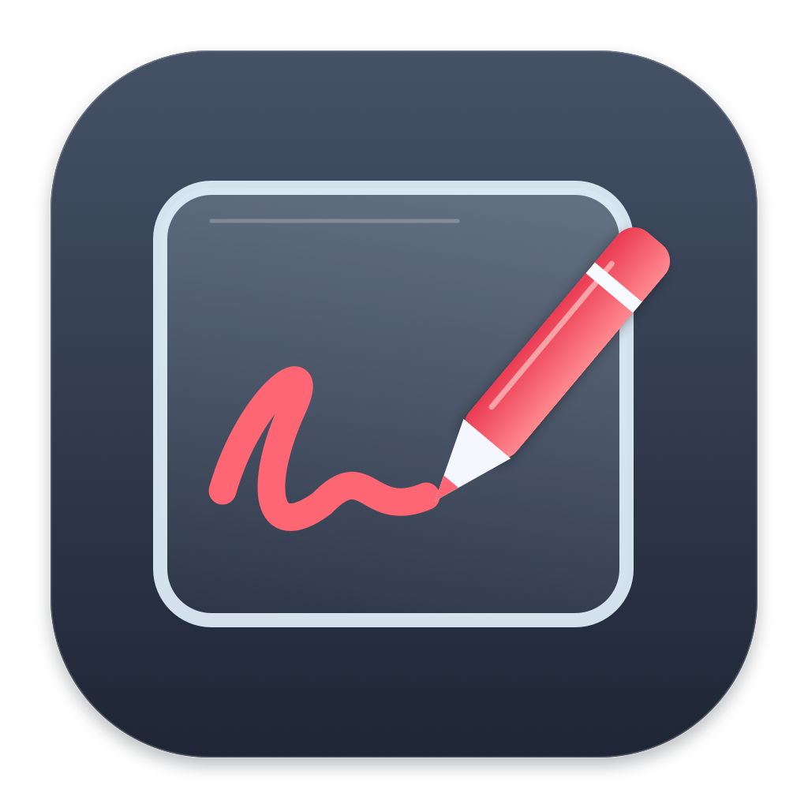

<p align="center"></p>

# 简笔白板 ｜ SimpleBoard

一个轻量的 macOS 白板与桌面批注工具。菜单栏常驻，屏幕边缘随手呼出，用完收起。深色磨砂玻璃工具栏，可调色画笔和红色等宽文字；不登录、不联网。普通绘图和吸色无需录屏权限，可选的区域配对需屏幕读取授权。

## 功能

- 非侵入式启动：不占 Dock / ⌘Tab，不自动弹白板或激活绘图，默认只留 28×52 点的边缘入口。
- 点击入口展开工具条；收起时隐藏画布和工具条，保留笔迹、颜色与撤销记录。菜单栏可再次展开、隐藏边缘入口或退出。
- 实色画板与透明桌面批注两种模式；实色画板可在样式面板选择白板或黑板，切换时保留内容。
- 画笔、直线、箭头、矩形、连续编号、文字输入和纯文字粘贴。
- 聚光框：拖动框选保留明亮区域，周围压暗；可穿透操作网页，框内画面实时显示，无需读取屏幕。
- 透明模式下选择箭头工具，点击与滚动可穿透至下方应用。
- 撤销、重做、可调整的线宽和文字大小。
- 画笔 / 直线 / 矩形支持预设色及 RGB 调色；已有笔迹和文字颜色不受影响。
- 像素直尺与系统放大镜吸色，选定后显示 sRGB 值，支持复制和用于画笔。
- 吸色后框选区域进行颜色配对：匹配颜色保留亮度，其余压暗。只读一次选区，不保存、不上传。
- 76 点宽的双列图标工具栏，系统玻璃背景；悬停查看名称与快捷键，底部保留当前工具或下一个编号。

**内容仅保存在当前会话。退出或崩溃后不保留，当前没有保存、导出或自动恢复功能。**

## 安装

当前发布包面向 **Apple Silicon（M 系列）Mac，macOS 13 或更新版本**。Intel Mac 尚未提供经过验证的安装包。

下载发布包，解压后将「简笔白板.app」放入「应用程序」。更新前先退出旧版本，再替换原应用，避免留下多个副本。

应用仅使用本地 ad-hoc 签名，**未经过 Apple 公证**。从 GitHub 下载后可能出现系统验证提示；请核验来源后按 macOS 的安全提示处理，或自行从源码构建。不要关闭全局安全保护。

启动后看屏幕左侧的铅笔入口或菜单栏的铅笔图标，不会出现普通应用窗口。展开默认是透明选择模式，可以正常操作网页；点击画笔才开始批注。透明模式中选择 V 或切到其他应用会恢复点击穿透，批注仍保留。白板模式切到其他应用会隐藏白色画布。

「收起」隐藏工具条和批注但不删除，重新展开恢复；「退出」结束进程且不保存内容。可在菜单栏取消「显示边缘入口」，只保留菜单栏图标。不会自动设置开机启动。

## 快捷键

| 按键 | 操作 |
| --- | --- |
| A | 画笔 |
| Q | 直线 |
| E | 箭头；Shift 拖动约束角度 |
| W | 矩形；Shift 拖动为正方形 |
| N | 连续编号，单击放置 |
| S | 聚光框，拖动框选 |
| T | 点击画布输入文字 |
| V | 选择；透明模式下可操作下方应用 |
| Z / ⌘V | 在鼠标位置贴入红色等宽纯文字 |
| C | 清空，不退出；可撤销 |
| X | 清空并退出 |
| ⌘Z / ⌘⇧Z | 撤销 / 重做 |
| ⌘B | 切换白板 / 透明模式 |
| ⌘, | 显示工具面板 |
| ⌘Q | 退出 |
| ⌘H | 收起，保留内容 |
| ⌘/ 或 ? | 帮助与快捷键（非输入状态） |
| Esc | 取消草稿、测量和聚光；文字输入时仅取消文字 |

快捷键只在白板处于前台时生效，**不是全局快捷键**。展开工具条不会接管其他应用的键盘；点击画笔等绘图工具后，才可使用 A/Q/W/Z 等快捷键。文字输入时，字母正常输入，⌘C 正常复制；Enter 换行、⌘Enter 完成、Esc 取消。

## 样式和工具

工具条顶部可拖动，「白 / 透」（黑板时为「黑 / 透」）切换模式。八个图标按双列排列：选择 / 画笔、直线 / 箭头、方形 / 编号、文字 / 聚光框。下面是撤销 / 重做、贴文字 / 清空、样式 / 收起。点击滑杆图标打开「样式和工具」：面板宽 264 点，顶部下拉菜单可选择「白板 / 黑板」，其下为颜色、粗细、字号与折叠入口；长说明在「？」或 ⌘/ 打开的可滚动帮助窗口内。

- **白板 / 黑板**：样式面板顶部设置实色画板的底色，自动记住选择，透明模式保持透明。仅改变背景，不修改笔迹、编号或文字颜色；默认文字仍为红色。工具栏点击「白」或「黑」进入对应画板。

- **画笔颜色**：点击大色块打开系统调色盘，或点选一排常用色；展开「精确颜色」可输入 RGB / HEX，回车或点击「应用」。已有笔迹不变，文字仍为红色。
- **粗细和文字**：粗细滑杆带笔划预览和数值，字号在同一层直接选择。
- **像素直尺**：点击直尺按钮，在画布拖动起点至终点。读数包含直线距离、横纵差值以及逻辑点距离。`px` 为当前画布的渲染像素（逻辑点 × backing scale），不是网页 CSS 像素，在缩放显示模式下也不等于面板原生物理像素。测量不写入笔迹或撤销历史；Esc、C 或切换工具可移除测量线。仅在当前画布所在屏幕测量，不支持跨屏拖动。
- **更多工具 → 吸色**：打开 macOS 原生放大镜，单击选定颜色后显示 sRGB，悬停读数查看 HEX；Esc 取消且保留旧结果。结果的「⋯」菜单提供复制 RGB 与用于画笔，不自动覆盖剪贴板或画笔颜色。取色时暂时隐藏画布和工具栏，结束后恢复。

### 箭头、编号与聚光

- **箭头 E**：拖动起点到箭头尖端，Shift 约束为 45° 的倍数。颜色和粗细沿用画笔设置，支持撤销和重做。
- **编号 N**：单击依次放置 1、2、3…，支持两位数及以上。颜色沿用画笔、大小随字号，数字自动选择黑色或白色以保持可读。撤销后继续补号，清空后从 1 开始；撤销清空会恢复笔迹与编号进度。
- **聚光框 S**：拖动一个矩形，框外覆盖半透明暗色、框内保持透明。透明模式下按 V 可点击和滚动网页，聚光继续显示；无需录屏或辅助功能权限。Esc 或 C 关闭，收起隐藏、展开恢复；屏幕布局变化时关闭以避免错位。聚光是临时效果，不写入笔迹撤销历史。未完成的拖动在切换工具或应用时取消，保留先前已完成的框。

### 取色与权限

吸色使用 `NSColorSampler`，无需为本应用授予屏幕录制权限。系统负责放大镜交互，只将用户选定的颜色返回应用，不向应用提供桌面图像。

原生接口不提供鼠标移动时的颜色回调，因此 RGB 在点击确认后显示，不是实时数字预览。不使用区域配对时可以撤销录屏权限，普通吸色不受影响。

### 框选配对（macOS 15.2+）

1. 在「更多工具」中吸色，确认后点击结果下方的「框选配对」。
2. 直接进入框选，不再使用旧式权限预检查阻拦操作，也没有单独的「首次请求 / 检查授权」。系统在实际读取时执行权限检查，首次可能显示系统授权提示；拒绝后结束本次配对，不自动重试。普通吸色照常可用。
3. 拖动框选要比对的区域（可框图例或图像），松开后只读取该选区一次。框选不跨屏，每次最多 1600 万渲染像素。
4. 结果是一张覆盖在原位置的**静态快照**：匹配像素保持原亮度，其余压暗至约 22%；区域外不变。HUD 显示匹配数量、容差与退出按钮。没有匹配时明确显示「未匹配到颜色」。
5. 默认每个 sRGB 通道允许 ±12 的差值，可在 0–40 调节；0 为精确匹配。滑动只重算已有快照，不会再次读取屏幕。不是图例识别或数值反演，也不代表物理量相等。
6. Esc、右键、关闭按钮、屏幕布局变化或收起均结束配对，释放图像引用。框选或显示结果时切换应用也会结束。读取已经发出后，系统弹窗造成的失焦不会丢弃回调；如果读取完成时白板不在前台，结果等回到白板才显示，不抢占其他应用。需再次配对时重新框选，不跟踪网页滚动或视频变化。

区域读取使用 `SCScreenshotManager.captureImage(in:)`，没有持续屏幕流、音频采集、截图文件或网络传输。macOS 的授权页面可能使用「屏幕录制」字样，功能本身只执行一次区域截图。权限改变后系统可能要求重新打开应用。受保护内容可能无法读取；显示缩放、色彩管理、压缩及抗锯齿可能造成颜色差异，可调整容差。macOS 13–15.1 保留原有功能，但不提供区域配对；不会退回整屏读取方案。

只有实际读取返回权限拒绝时才显示设置入口，其他读取错误显示错误域和代码，不一律归咎于权限。应用不要求配置开发者证书或钥匙串，不修改、清空或重置系统权限数据库。默认包为 ad-hoc 签名，系统可能在更新后要求重新确认授权；本机实际读取结果仍需实机验收。

## 从源码构建

需要 macOS 和 Xcode 或 Command Line Tools，无第三方依赖。

```sh
bash native/build.sh
```

生成 `outputs/简笔白板.app` 和 `outputs/简笔白板-macOS.zip`。脚本默认编译 arm64，最低部署版本为 macOS 13。

```sh
# 重新生成图标（可选，仓库已包含 PNG 和 ICNS）
bash native/build-icon.sh
# 回归测试
bash native/test.sh
# 构建应用、生成干净源码包、发布包和校验和
bash native/package.sh
```

测试覆盖折叠面板、RGB / HEX、笔划预览、窗口层级、直尺、颜色配对容差、原亮度保留、压暗、零匹配及区域坐标换算。测试不读取屏幕；真实系统授权、截图与覆盖定位需在桌面手动验收。可通过 `SIMPLEBOARD_MATCH_FIXTURE=/path/to/image.png bash native/test.sh` 用本地图片检验算法（仅测试程序在 work/ 写验证图片，正式应用不保存截图）。

## 项目结构

```text
assets/       图标、可编辑矢量绘图源代码
native/       AppKit 应用、测试和构建脚本
docs/         使用及发布说明
CHANGELOG.md  版本记录
```

图标由 `assets/DrawIcon.swift` 中的矢量路径生成，每个分辨率独立绘制，外部为透明背景；不包含第三方品牌图形。应用内工具符号使用系统 SF Symbols，不随源码另行分发符号素材。

## 隐私与限制

- 无网络请求、遥测、账户或后台服务。
- 无需辅助功能权限；普通绘图和原生吸色不需要录屏权限。
- 吸色使用系统 `NSColorSampler`，仅接收选定颜色。只有用户主动框选配对时才使用屏幕读取授权，单次读取选区、不持续录制、不保存或上传截图。
- 仅在用户执行粘贴时读取剪贴板纯文字。
- 减少透明度等系统辅助功能设置会影响玻璃效果。
- 当前画布对应启动时所在屏幕，不提供多屏独立画布管理。

## 贡献与发布

欢迎报告可复现的问题；请提供版本、macOS 版本和操作步骤，不要公开带有个人信息的原始崩溃日志。发布流程见 [docs/RELEASING.md](docs/RELEASING.md)。

## 许可证

本项目采用 [MIT License](LICENSE)，Copyright (c) 2026 MeowFTG。

仓库中的应用代码、文档、原创图标及其绘图源码均按 MIT 许可证提供。应用内使用的系统 SF Symbols 不属于本项目的授权范围，适用 Apple 自身条款。
